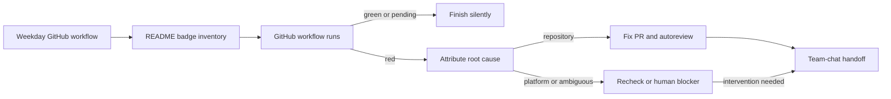

# CI/CD Sheriff

A weekday GitHub Actions workflow that watches exactly the workflow status badges displayed at the top of `README.md`, three times a day. Green runs are silent. Red runs are diagnosed by a coding agent; when the repository is responsible, the agent prepares a focused fix PR, takes it through [`autoreview`](../../skills/autoreview/) to merge-ready, requests a human reviewer, and hands it to the team chat for a person to approve and merge. Pull requests that touch the sheriff exercise detection without being granted repair or notification permissions.

## Files

| File | Installs as | Role |
| --- | --- | --- |
| [`workflow.yml`](workflow.yml) | `.github/workflows/cicd-sheriff.yml` | Schedule, permissions, the detect job, the gated repair job, the chat handoff |
| [`check_readme_workflows.py`](check_readme_workflows.py) | `ci/check_readme_workflows.py` | Reads the badge inventory and classifies each workflow's latest `master` run as green, red, pending or unreadable |
| [`skills/cicd-sheriff/SKILL.md`](skills/cicd-sheriff/SKILL.md) | `skills/cicd-sheriff/` | Diagnosis, repair, review and handoff contract the agent follows |
| [`skills/sheriff/SKILL.md`](skills/sheriff/SKILL.md) | `skills/sheriff/` | `/sheriff`, the on-call alias for the production alarm review skill (not shipped here; see below) |
| [`tests/`](tests/) | `ci/tests/` | Detector unit tests and workflow contract tests, run by the detect job on every relevant PR |
| [`../../routines/cicd-sheriff/PROMPT.md`](../../routines/cicd-sheriff/PROMPT.md) | `routines/cicd-sheriff/PROMPT.md` | The repair job's prompt, committed so the routine registry and the workflow share one source |

## Goal and scope

Keep the repository's published CI status inventory green, without broadening the task into unrelated workflows, production alarms, dependency updates or release monitoring. Requirements:

- `README.md` is the monitored inventory.
- A red status is attributed before any code changes; platform failures never justify speculative repository patches.
- Repository fixes reach a merge-ready PR through `autoreview`, but the automation never merges.
- The team chat is quiet when everything is green and receives one handoff only after intervention or when a human-only blocker remains.
- The schedule, permissions, detector tests, repair trigger and chat handoff are versioned and testable in the repository.

## Decisions

- **GitHub Actions is the scheduler,** not a cloud agent automation. The workflow, its permissions, its schedule, the repair gate and the PR-safe detector tests all stay reviewable in one repository, and a change to any of them is tested in its own PR. The cost, accepted: the watchdog cannot run during an Actions outage, so it cannot report the outage itself; the next successful run checks whatever the outage left red.
- **The README badge block is the only inventory.** This keeps the scope aligned with the repository's visible health contract instead of sweeping manual bots and infrastructure workflows that happen to run on `master`. A hardcoded list in the skill would drift; the badges are what people actually look at. Path-filtered badges keep their latest completed status when no new run triggers, a badge with no `master` run is red rather than invisible, and a workflow merged together with its badge waits for its first run instead of reading red.
- **Detection and repair are separate jobs with separate permissions.** The detect job is read-only and runs on PRs; only a scheduled run, or a manual one dispatched from `master` with `repair: true`, can start the repair job with write permissions.
- **Human merge authority is preserved.** `autoreview` is the automated quality gate; a person approves and merges. An agent that both writes and merges the fix for a broken pipeline is one bad diagnosis away from making it worse.
- **The chat is intervention-only, and the agent never holds its token.** The agent writes its handoff to a file; a deterministic step posts it after the agent exits. A green-confirmation feed would get muted within a week.
- **The agent runs as an app, with one borrowed write.** GitHub forbids the Actions token from opening PRs, so the agent authenticates as the Claude GitHub App. That app token cannot re-run workflows, so the single `gh run rerun` call borrows the Actions token through `GH_RERUN_TOKEN`.

Alternatives considered and set aside: running the sheriff as a cloud agent automation (its schedule and permissions would live outside the repository, untestable in a PR), and sweeping every workflow on `master` (most of them are not anyone's health contract, and the noise would bury the ones that are).

## Dragons

- **An Actions outage disables the monitor together with the workflows it watches.** Accepted, for the reviewability above; the next successful run handles any status that remains red.
- **Scheduled runs can overlap a long repair and open duplicate PRs.** Addressed: scheduled and manual runs share one serialized repair concurrency group, PR validation uses independent groups, and the skill resumes an open sheriff PR for the same workflow and root cause instead of opening another.
- **A cancelled run is either a real timeout or a benign supersession.** Addressed: diagnosis reads the run's timing, jobs, concurrency policy and newer runs before deciding.
- **A repository-caused red stays visible until a human merges the prepared fix.** Accepted: an automatic merge would violate the human-approval requirement; the chat handoff makes ownership visible.
- **Chat delivery depends on the token and channel being configured.** Addressed: the post step fails loudly on a missing token or a rejected post, and a run whose agent failed without writing a handoff still posts a link to the run.
- **PRs opened with automation credentials may not trigger downstream checks.** Open: validate one repair PR end to end; `autoreview` must stop and report rather than claim merge readiness when checks never register.

## Wiring it up

- Repository secret `CLAUDE_CODE_OAUTH_TOKEN` for Claude Code's GitHub Action, and the Claude GitHub App installed on the repository.
- Repository secret `CHAT_BOT_TOKEN`, repository variables `CHAT_ENG_CHANNEL` and `CICD_SHERIFF_REVIEWER` (a GitHub login), and the chat API URL in the post step.
- A `Sheriff` label, the [`autoreview`](../../skills/autoreview/) skill available to the agent, and a badge block at the top of `README.md`, grouped under `###` headings and closed by a line of dashes.
- The `sheriff` alias points at an alarm-review skill of your own (`review-alarms`): the on-call engineer's triage of production alarms, which stamps its issues and PRs with the same `Sheriff` label. That skill is about one company's infrastructure and is not shipped here; the alias is, because `/sheriff` is what people type on call.
