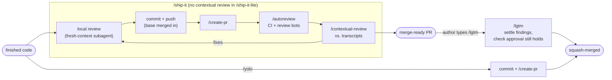

# Skills

Agent skills in the open `SKILL.md` format: a folder per skill with its instructions (`SKILL.md`), the files it loads on demand (`references/`, `scripts/`), and a `README.md` for people saying what it is, why it exists, how it fits, and what to wire up. Every skill was written against [`rules/WRITING_FOR_AI_AGENTS.md`](../rules/WRITING_FOR_AI_AGENTS.md) and assumes the engineering rules in [`rules/AGENTS.md`](../rules/AGENTS.md) are loaded beside it, so no skill restates a rule.

Two conventions run through all of them. Each skill ends by naming the skills it used, so a transcript shows which instructions drove a turn. And each one ends with "if this skill's instructions failed or needed a workaround, update this file": the agent that hit the gap fixes the instructions while the evidence is in front of it.

## The delivery pipeline

From finished code to a merged PR. The `ship-it*` shortcuts never merge; `/lgtm` and `/yolo` are the author's merge approval.

| Skill | One line |
| --- | --- |
| [`ship-it`](ship-it/README.md) | Local review, commit, `/create-pr`, `/autoreview`, then `/contextual-review`, to a merge-ready PR. Never merges. |
| [`ship-it-lite`](ship-it-lite/README.md) | The same without the session-transcript review, for low-risk changes. |
| [`lgtm`](lgtm/README.md) | The author's approval as a command: from wherever the branch is to a conditional self-merge that goes stale if the change grows. |
| [`yolo`](yolo/README.md) | Commit, PR, squash-merge. No review, no CI wait. |
| [`create-pr`](create-pr/README.md) | Opens or refreshes a draft PR with a "to judge" line and fixed sections. |
| [`autoreview`](autoreview/README.md) | Babysits the PR: CI, base merges, and every review item triaged into fix, skip or leave open. |
| [`contextual-review`](contextual-review/README.md) | Reviews the diff against the session transcripts for intent fidelity and design drift. |
| [`simplify`](simplify/README.md) | Fresh-eyes, behavior-preserving cleanup of the branch's own changes. |
| [`test`](test/README.md) | A test-fix loop that re-runs narrowly and knows when to stop. |

How they chain:

- **`/ship-it`** runs the whole box; **`/ship-it-lite`** stops after `/autoreview`. Both end at a merge-ready PR and a summary of skipped findings and pending decisions.
- **`/lgtm`** enters wherever the branch is (no PR yet, PR in review, PR ready), runs the local review on what the bots have not seen, `/create-pr` if needed and `/autoreview`, settles the remaining findings with the authority the approval grants, and merges only if what changed since the approval is trivial or a fix within the PR's stated intent.
- **`/yolo`** skips every review.
- `/simplify` runs before each commit; `/test` runs wherever a check fails.

## Design and research

| Skill | One line |
| --- | --- |
| [`problem-definition`](problem-definition/README.md) | States the problem before anyone picks a solution. |
| [`design`](design/README.md) | Options, dragons and user-made decisions, recorded in a doc that keeps only what the code cannot show. |
| [`design-review`](design-review/README.md) | Finds what the design missed, then cuts the doc down to the result. |
| [`prototype`](prototype/README.md) | One question round, an autonomous build, split decision ledgers, a draft PR to try and discard. |
| [`state-of-the-art-research`](state-of-the-art-research/README.md) | Literature by researcher subagents plus our own data, in a report that teaches and ranks directions. |
| [`benchmark-models`](benchmark-models/README.md) | Comparing models, efforts, providers and harnesses for one call site without fooling yourself. |
| [`read-user-sessions`](read-user-sessions/README.md) | Read real customer sessions, customers and staff apart, before a behavior-sensitive decision. |

## Autonomy

| Skill | One line |
| --- | --- |
| [`afk`](afk/README.md) | The user is away: keep going to a merge-ready PR, with a decision ledger instead of questions. |
| [`afk-teleport`](afk-teleport/README.md) | The same, moved into a cloud session first so it survives the laptop closing. |
| [`siesta`](siesta/README.md), [`siesta-teleport`](siesta-teleport/README.md) | Aliases of the two above. |
| [`checkout`](checkout/README.md) | A fresh branch that never tracks the default branch. |
| [`fork`](fork/README.md) | A fresh, fully set-up worktree, opened where you start agent sessions. |

## Context and memory

| Skill | One line |
| --- | --- |
| [`cleanup-context`](cleanup-context/README.md) | Measures what the agent loads and trims rule files and skills to what changes behavior. |
| [`dream`](dream/README.md) | Monthly: verify and consolidate memories, learn rules and checks from the user's corrections, retire rules that no longer pay. |

## Misc

| Skill | One line |
| --- | --- |
| [`test-browser`](test-browser/README.md) | Verifies web app changes route by route in the editor's browser. |
| [`snippets`](snippets/README.md) | A biweekly work report for the whole team from GitHub, sessions, calendar and email. |
| [`spanish-copy`](spanish-copy/README.md) | Spain-Spanish register guide: the model tics to avoid. |
| [`find-skills`](find-skills/README.md) | Searches public skill catalogs for a skill that fits the task, checks it against a security registry, and installs it into the repository. Adapted from vercel-labs/skills (MIT). |

## Using them

Link or copy the skill folders into your coding agent's skill folder (a project-level folder such as `.agents/skills/`, or whatever path your agent reads; a symlink lets several agents share one copy). Each README's "Wire up" names what the skill expects from your repository: usually a script path, a docs folder, or the names of your review bots. Copy `rules/AGENTS.md` alongside, since the skills reference its sections by name.

The unattended issue agent runs vendored copies of the pipeline skills with extra steps of its own; see [alice-issue-agent](https://github.com/alexandrosandre/alice-issue-agent).
